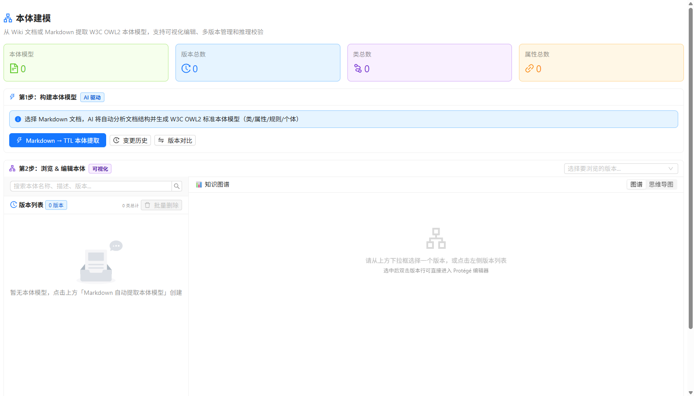
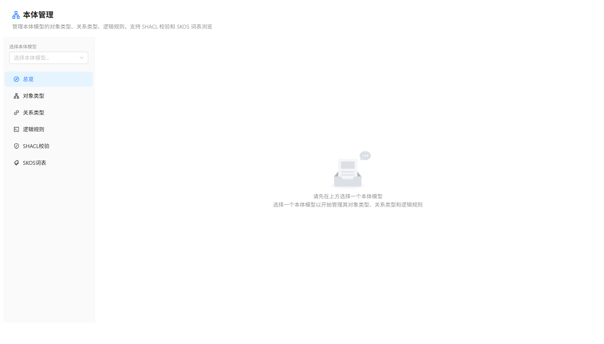
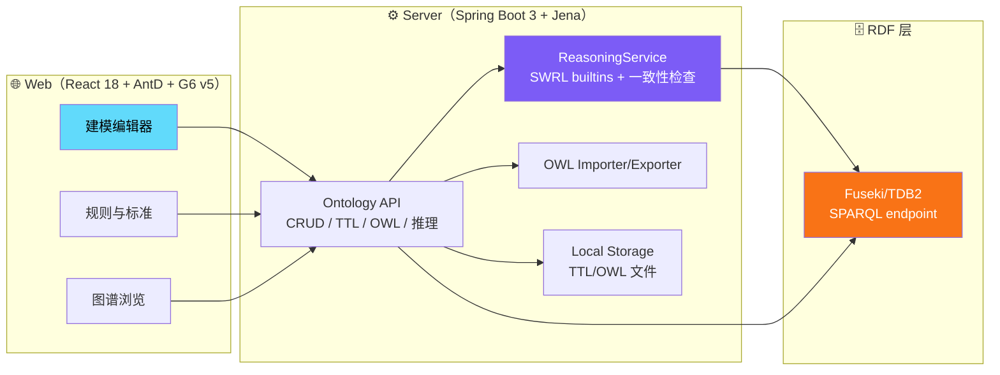

<div align="center">

# 🧩 Ontology Builder

**AI 原生本体建模工作台 — 抽取、建模、推理、校验、实例化、可视化，一条链打通**

[](web/)
[](server/)
[](server/src/main/java/com/ontologybuilder/ontology/service/reasoning/)
[](LICENSE)

</div>

---

### English

**Ontology Builder** is an AI-native ontology modeling workbench: feed documents or schemas to an AI extraction wizard, refine in a Protégé-style editor, enforce standards with SHACL/SKOS, encode logic as SWRL rules, run consistency reasoning (Pellet/Openllet + custom SWRL builtins), instantiate via RML mapping, and explore instances as an interactive graph (SPARQL + G6). Versioned, OWL/TTL import-export ready, with a self-contained Spring Boot 3 + Jena server.

> 中文文档见下。

---
**Ontology Builder** 是一个 AI 原生的本体（Ontology）建模工作台：把文档、表结构喂给 AI 抽取向导生成本体草稿，专家在 Protégé 风格编辑器里精修，用 SHACL/SKOS/SWRL 固化标准与规则，跑一致性推理校验，再经 RML 映射实例化到 RDF 存储，最后用 SPARQL + G6 图谱可视化浏览。

## ✨ 一分钟看懂

```text
文档/表结构 → AI 抽取草稿 → 专家建模精修（Protégé 风格画布）
    → SHACL 约束 / SKOS 词表 / SWRL 逻辑规则
    → 一致性推理校验（Pellet + 自研 SWRL builtins）
    → 版本管理 + Diff → OWL/TTL 导入导出
    → RML 映射实例化 → SPARQL + G6 图谱浏览
```



## 🏛️ 三大工作区

| 工作区 | 路由 | 核心能力 |
|---|---|---|
| **抽取与建模** | `/modeling` | AI 抽取向导 · 类层次树 · 属性编辑器 · Protégé 风格编辑抽屉 · 推理结果面板 · TTL 源码查看 · 校验面板 · 版本列表与 Diff |
| **规则与标准** | `/manager` | SHACL 约束视图 · SKOS 词表视图 · SWRL 逻辑规则可视化配置 · 关系类型图 · 可视化编辑器 · 发现视图 |
| **实例数据浏览** | `/browser` | SPARQL 查询 · RDF 实例浏览 · G6 v5 图谱可视化 |




## 🏛️ 架构



## 📦 目录结构

```text
Ontology-builder/
├── server/                      ⚙️ Spring Boot 3 后端（Java 17）
│   └── src/main/java/com/ontologybuilder/
│       ├── ontology/            本体 CRUD / OWL 导入导出 / AI 抽取联动
│       │   └── service/reasoning/  自研推理：SWRL builtins（Abs/Not/StrContains…）+ 一致性检查
│       ├── oxirs/               RDF 查询执行 / 神经符号校验 / 规则晋升调度
│       ├── connector/           文件上传（TTL/OWL）+ 本地存储策略
│       └── common/              统一响应 / 异常 / TTL 语法修复工具
├── web/                         🌐 React 前端（浅色主题）
│   └── src/pages/
│       ├── Ontology/            建模工作区（11 组件 + 5 hooks）
│       ├── OntologyManager/     规则与标准（11 组件，SHACL/SKOS/逻辑规则）
│       └── DataBrowser/         实例浏览（SPARQL + vis-network/G6）
├── docs/
└── README.md
```

## 🚀 Quick Start

### 后端

```bash
cd server
# 依赖：Java 17 + Maven + PostgreSQL + Fuseki（或内置 TDB2）
./mvnw spring-boot:run          # 默认 :8080，API 前缀 /api/v1
```

### 前端

```bash
cd web
npm install
npm run dev                     # 默认 :5173，代理 /api → :8080
```

打开 `http://localhost:5173/ontology/modeling` 开始建模。

## 🛡️ 内置推理能力

| 能力 | 实现 |
|---|---|
| SWRL 内置函数 | `SwrlAbs` `SwrlNot` `SwrlStrContains` `StringEqualIgnoreCase` `MultiArgSum` `StringLength`（自研注册） |
| 一致性检查 | `OntologyConsistencyChecker`（Jena + Pellet/Openllet 双通道） |
| 神经符号校验 | `NeuroSymbolicVerifier`（LLM 候选 + 符号验证） |
| 规则晋升 | `RulePromotionScheduler`（草稿规则按评估分自动转正） |
| SHACL 校验 | Jena SHACL 引擎 |

## 🙏 致谢

推理与 RDF 能力构建在开源生态之上：[Apache Jena](https://jena.apache.org/)、[Openllet](https://github.com/Galigator/openllet)、[HermiT](http://www.hermit-reasoner.com/)、[AntV G6](https://g6.antv.antgroup.com/)。

## 📄 License

Apache-2.0
